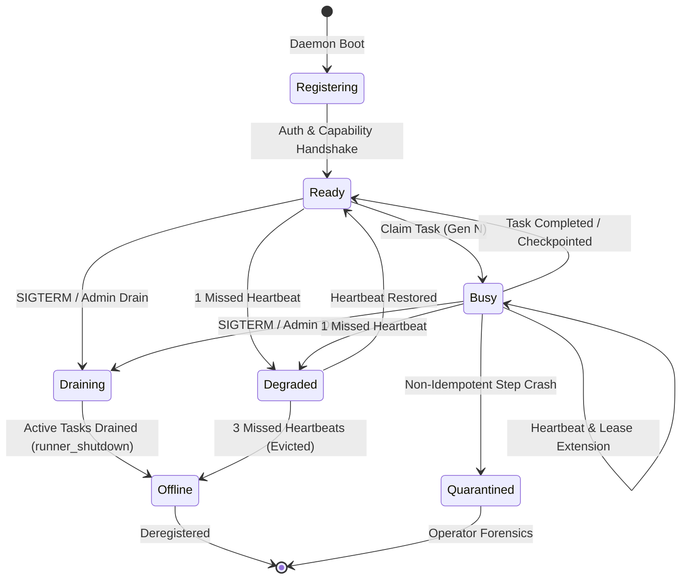

# ADR 0034: Remote Worker Daemon and Heartbeat Distribution

**Status:** Accepted
**Date:** 2026-10-29
**Deciders:** PersonaOS Architecture Team
**Consulted:** Node Lifecycle, Workload Execution, Runtime Adapters, Reliability Engineering
**Informed:** Platform Operators, Security Team

---

## Context & Problem Statement

In PersonaOS v0.1, the worker execution model established a fundamental architectural axiom (ADR 0003, ADR 0024):
> *"Worker is identity; Node is execution location. Worker survives model and runtime changes; Node is replaceable."*

In v0.1, `WorkerRunner` and `NodeSupervisor` were verified in a local process model (`tests/integration/test_node_lifecycle_supervision.py`, `tests/integration/test_persistent_worker_compute_replacement.py`). In v0.2, workers execute on heterogeneous, remote physical and virtual hosts (remote worker daemons) distributed across corporate networks, edge infrastructure, or developer workstations.

Key distribution challenges:
1. **Network Jitter & Heartbeat Loss:** Transient network packet drops must not trigger premature eviction or destructive task reclamation while a worker is actively executing long-running steps.
2. **Clock Skew Across Hosts:** Relying on unsynchronized local clocks across distributed worker nodes can cause premature lease expiration or claim collisions.
3. **Split-Brain Worker Execution:** A worker node that experiences a network partition, is declared dead, and recovers must be strictly prevented from writing late results or checkpoints that corrupt subsequent task state.
4. **Side-Effect Safety During Worker Eviction:** If a worker node crashes or disconnects while performing a non-idempotent side effect (e.g., executing a deployment or payment API call), the control plane must not blindly re-dispatch the task.

---

## Decision Drivers

- **Deterministic Generation Fencing:** Every task claim and lease renewal must be fenced by a monotonically increasing generation integer.
- **Server-Authoritative Time:** All lease timeouts, heartbeat timestamps, and deadlines are computed strictly according to the PostgreSQL server clock (`NOW()`), eliminating dependency on client node NTP synchronization.
- **Side-Effect Quarantine:** Ambiguous in-flight failures must trigger safe quarantine (`status = 'quarantined'`, `review_reason = 'unhandled_runtime_error'`) rather than uncontrolled retries (ADR 0016, 0018).
- **Graceful Draining & Node Lifecycle:** Support intentional worker daemon scaling, drain modes (`graceful_drain`), and unbinding without task abandonment.

---

## Decision

We will implement the **Remote Worker Daemon and Distributed Heartbeat Architecture**:

### 1. Remote Worker Daemon (`personaos-worker-daemon`)
- A standalone daemon process deployed on remote execution nodes.
- Exposes node metadata: hardware capabilities (`cpu_arch`, `gpu_type`, `memory_gb`), installed toolchains (`docker`, `kubectl`, `openclaw`), and local adapter runtimes.
- Maintains a bidirectional control connection or authenticated HTTPS/WebSocket heartbeat loop with the PersonaOS control plane.

### 2. Server-Authoritative Heartbeat & Lease Contract
- Heartbeats are issued at regular intervals:
  - `heartbeat_interval`: Default `5.0s`.
  - `heartbeat_timeout` (Node Dead Threshold): Default `15.0s` (3 missed heartbeats).
  - `task_lease_ttl`: Default `30.0s`.
- Worker heartbeats update the node table and in-flight task leases in an atomic database operation:
  ```sql
  -- Node heartbeat renewal
  UPDATE worker_nodes
  SET last_heartbeat_at = NOW(),
      status = 'ready',
      updated_at = NOW()
  WHERE id = :node_id;

  -- Active task lease extension (guarded by generation and node binding)
  UPDATE tasks
  SET lock_expires_at = NOW() + INTERVAL '30 seconds',
      updated_at = NOW()
  WHERE id = :task_id
    AND assigned_node_id = :node_id
    AND generation = :expected_generation;
  ```
- All durations are evaluated on the central PostgreSQL instance. Client clock drift has zero impact on lease expiration.

### 3. Fencing Token Rejection (Split-Brain Defense)
- When a worker daemon's heartbeat lapses beyond `heartbeat_timeout`, the control plane's `NodeSupervisor` marks the node `unhealthy` or `offline` and releases or reclaims uncommitted tasks by incrementing `generation = generation + 1`.
- If the partitioned worker later attempts to submit a checkpoint or completion, the update predicate `generation = :expected_generation` returns 0 rows.
- Upon receiving a `StaleGenerationError` (HTTP 409 / JSON-RPC `-32009`), the remote daemon must immediately execute a fail-closed local abort:
  1. Terminate local subprocesses (SIGTERM followed by SIGKILL).
  2. Discard uncommitted local buffers.
  3. Emit a diagnostic event and deregister its local node session.

### 4. Side-Effect Awareness in Worker Eviction
- As established in ADR 0016 and ADR 0021, when a node is evicted mid-task:
  - If the last recorded checkpoint has `is_idempotent = true`, the task may be scheduled for safe reclamation on an alternate node.
  - If the task was interrupted during a non-idempotent action (`is_idempotent = false`) or between ambiguous external API calls, the supervisor transitions the task to `status = 'quarantined'`.
  - Quarantined tasks require human operator or automated reviewer review (ADR 0018) before resumption, preventing duplicated external mutations.

### 5. Node Shutdown & Drain Lifecycle
- Daemon responds to `SIGTERM` / `SIGINT` by entering `status = 'draining'`:
  - Ceases claiming new tasks (`available_capacity = 0`).
  - Awaits completion or safe checkpoint of current in-flight tasks up to `drain_timeout` (default `60s`).
  - On clean completion, marks node unbinding reason as `runner_shutdown` (or `graceful_drain` if aborted mid-task) per ADR 0024 and commit `c4c3873`.

---

## Worker Lifecycle State Machine



---

## Consequences

### Positive
- **Guaranteed Isolation:** Severed worker nodes cannot corrupt subsequent work or overwrite newer checkpoints.
- **Immunity to Time Drift:** Central server-evaluated timestamps prevent NTP desynchronization bugs across distributed infrastructure.
- **Predictable Failure Containment:** Dangerous side effects are quarantined rather than retried blind, maintaining system integrity across sudden compute losses.

### Negative / Trade-offs
- **Network Overhead:** Frequent heartbeats from hundreds of worker nodes generate database write traffic (addressed by batching node heartbeat updates and tuning heartbeat jitter).
- **Fail-Closed Abort Cost:** Partitioned workers discard local intermediate progress once fenced, requiring re-execution from the last durable checkpoint.
