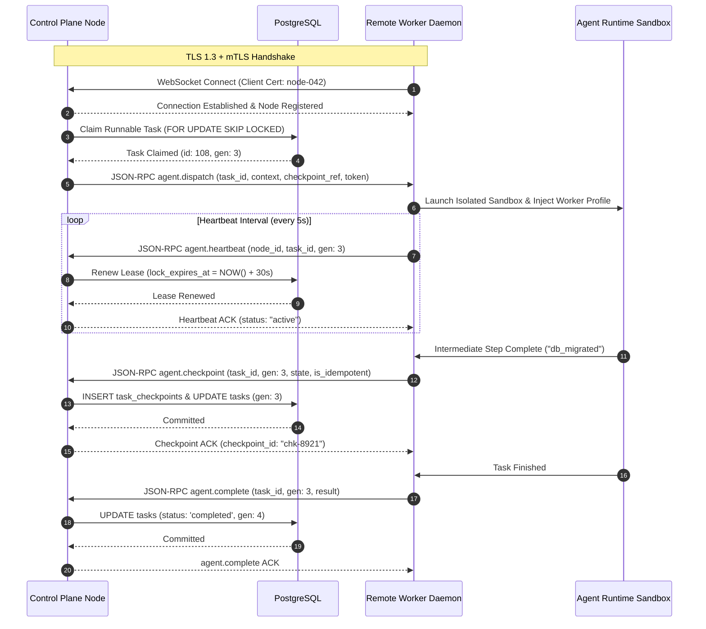

# ADR 0035: Cross-Machine Agent Execution Protocol

**Status:** Accepted
**Date:** 2026-10-29
**Deciders:** PersonaOS Architecture Team
**Consulted:** Security, Workload Execution, Runtime Adapters, Networking
**Informed:** Integration Partners, Platform Operators

---

## Context & Problem Statement

In PersonaOS v0.1, agent execution takes place via direct subprocess execution or local IPC (such as the OpenClaw ACP adapter communicating over stdio JSON-RPC 2.0 with a local gateway process, per ADR 0017). To achieve a truly distributed workforce across distinct machines, containers, and isolated cloud clusters, the control plane and remote worker runtimes must communicate over an explicit, secure, auditable, and resilient network protocol.

Key protocol requirements:
1. **Bidirectional Framing:** Control planes must dispatch tasks, stream input updates, and send cancel/pause signals. Remote workers must stream execution logs, state checkpoints, and completion events in near real-time.
2. **Mutual Authentication & Trust Isolation:** Untrusted remote worker nodes must not be able to impersonate other nodes, access tasks outside their assignment, or forge checkpoints. Control planes must verify worker identities cryptographically.
3. **End-to-End Traceability:** Multi-agent workflows spanning multiple machines must maintain complete observability with distributed trace correlation IDs across network hops.
4. **Resilient Reconnection:** Temporary network disconnects during execution must reconnect gracefully without losing execution context or corrupting in-progress state.

---

## Decision Drivers

- **Security as a Primitive (ADR 0004):** Never send plaintext credentials; enforce strict mutual authentication (mTLS) and scoped JWT tokens.
- **Protocol Consistency:** Align with existing JSON-RPC 2.0 framing proven in OpenClaw ACP (ADR 0017) to avoid disparate serialization paradigms.
- **Fail-Closed Sandbox Boundaries:** Workers operate within isolated execution sandboxes (containers or VMs) with zero write access to control plane databases or secrets outside their explicit assignment context.
- **Durable Checkpointing Over the Wire:** Checkpoints must be received, verified, and durably committed to PostgreSQL before acknowledging advancement to the remote runtime.

---

## Decision

We establish the **PersonaOS Cross-Machine Agent Execution Protocol (PMAEP)**:

### 1. Transport & Framing Layer
- **Primary Transport:** WebSocket over TLS 1.3 (WSS) for persistent bidirectional streaming; HTTPS REST for stateless control actions.
- **Message Serialization:** JSON-RPC 2.0 specifications (`jsonrpc: "2.0"`).
- **Core RPC Methods:**
  - `agent.dispatch`: Control plane pushes assigned task context, parameters, and checkpoint reference to worker.
  - `agent.checkpoint`: Worker streams intermediate execution state to control plane for durable persistence.
  - `agent.heartbeat`: Worker transmits periodic telemetry, health metrics, and lease renewal requests.
  - `agent.cancel`: Control plane issues immediate cancellation or interruption signal.
  - `agent.complete`: Worker returns final result artifacts, output payloads, and exit diagnostics.

### 2. Authentication & Cryptographic Trust Boundaries
- **Transport Security:** Mutual TLS (mTLS) with an internal or operator-managed X.509 Certificate Authority (CA). Both the control plane and worker daemons possess client certificates verifying their node identities (`CN=node-id.workers.personaos.internal`).
- **Application Tokens:** Each task dispatch payload includes an ephemeral, cryptographically signed `TaskAccessToken` (JWT):
  - Claims: `sub: worker_id`, `tid: task_id`, `nid: node_id`, `gen: generation`, `exp: lease_expiry`, `scope: ["checkpoint:write", "telemetry:emit"]`.
  - Signature: HMAC-SHA256 using an ephemeral per-task secret generated by the control plane.
- **Least Privilege:** A worker node certificate only allows connection to the worker gateway; it cannot access administrative REST endpoints or other workers' tasks.

### 3. Distributed Traceability & Context Propagation
- Every message envelope must carry distributed tracing metadata:
  - `trace_id`: 128-bit hex string identifying the end-to-end user workflow or DAG execution.
  - `span_id`: 64-bit hex string identifying the individual task or RPC invocation.
  - `correlation_id`: Logical correlation identifier tying back to user session or external trigger.
- Trace headers adhere to W3C Trace Context standards (`traceparent`).

### 4. Wire-Level Handshake & Checkpoint Flow

---

## Consequences

### Positive
- **Strong Isolation:** Remote workers operate outside the control-plane private network perimeter, safely executing user-authored or untrusted code in sandboxes.
- **Full Wire Observability:** Every remote execution step, log stream, and checkpoint is correlated with W3C trace identifiers.
- **Reconnection Resilience:** WebSockets with session resumption enable seamless recovery from brief network drops without losing task execution progress.

### Negative / Trade-offs
- **Certificate Lifecycle Management:** mTLS requires public-key infrastructure (PKI) or certificate provisioning tooling for worker daemons.
- **Protocol Overhead:** JSON-RPC over TLS introduces minor framing and cryptographic overhead compared to unencrypted local sockets (negligible for agent workloads).
