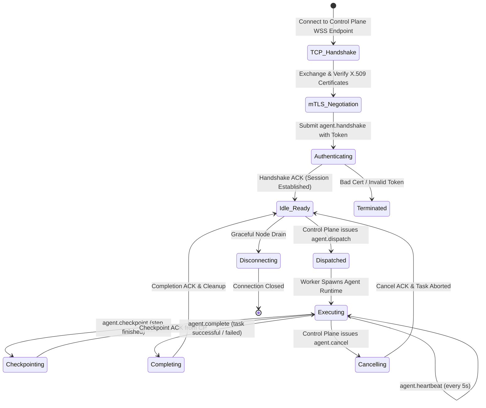

# Specification: Cross-Machine Agent Execution Protocol (PMAEP)

**Reference:** ADR 0035, Vikunja Milestone v0.2-C
**Module:** `personaos.protocol`, `personaos.execution.protocol`, `personaos.network`
**Source of Truth:** `schemas/protocol.yaml`, `schemas/task.yaml`, `schemas/event.yaml`

---

## 1. Protocol Architecture & Session Lifecycle

The **PersonaOS Cross-Machine Agent Execution Protocol (PMAEP)** governs wire-level communication between the control-plane cluster and distributed remote worker daemons. All interactions are framed using **JSON-RPC 2.0** transported over persistent **WebSocket connections secured by Mutual TLS 1.3 (mTLS)**.



---

## 2. Wire-Level JSON-RPC 2.0 Contract

Every wire message conforms to the standard JSON-RPC 2.0 specification, augmented with mandatory distributed tracing metadata.

### 2.1 Trace Context Envelope Header
All requests and notifications contain a top-level `meta` field:

```json
{
  "meta": {
    "trace_id": "4bf92f3577b34da6a3ce929d0e0e4736",
    "span_id": "00f067aa0ba902b7",
    "correlation_id": "req-usr-98124-workflow-alpha",
    "timestamp": "2026-10-29T12:00:00.000Z"
  }
}
```

---

### 2.2 Method: `agent.handshake` (Worker -> Control Plane)

Initiated by the remote worker daemon immediately upon WebSocket connection establishment.

#### Request:
```json
{
  "jsonrpc": "2.0",
  "id": "req-001",
  "method": "agent.handshake",
  "params": {
    "node_id": "node-prod-gpu-04",
    "hostname": "worker-gpu-04.internal.net",
    "daemon_version": "0.2.0",
    "capabilities": {
      "cpu_cores": 16,
      "memory_gb": 64.0,
      "gpu_type": "NVIDIA-A10G",
      "runtimes": ["docker", "openclaw_acp", "native_process"],
      "skills": ["python", "kubernetes", "finetuning"]
    },
    "max_concurrent_tasks": 4
  },
  "meta": {
    "trace_id": "11111111111111111111111111111111",
    "span_id": "2222222222222222",
    "correlation_id": "boot-node-prod-gpu-04",
    "timestamp": "2026-10-29T12:00:01.000Z"
  }
}
```

#### Response:
```json
{
  "jsonrpc": "2.0",
  "id": "req-001",
  "result": {
    "session_id": "sess-89a1c3f9",
    "heartbeat_interval_sec": 5.0,
    "lease_ttl_sec": 30.0,
    "registered_at": "2026-10-29T12:00:01.120Z",
    "status": "ready"
  }
}
```

---

### 2.3 Method: `agent.dispatch` (Control Plane -> Worker)

Dispatches an assigned task to the remote worker daemon for execution.

#### Request:
```json
{
  "jsonrpc": "2.0",
  "id": "disp-901",
  "method": "agent.dispatch",
  "params": {
    "task_id": "task-deploy-fms-812",
    "task_type": "system_deployment",
    "priority": 100,
    "generation": 3,
    "lease_ttl_sec": 30.0,
    "auth_token": "eyJhbGciOiJIUzI1NiIsInR5cCI6IkpXVCJ9...",
    "worker_snapshot": {
      "worker_id": "worker-devops-01",
      "persona": "DevOps Engineer",
      "profile_version": 2,
      "system_prompt": "You are DevOps Engineer for PersonaOS..."
    },
    "context": {
      "task_input": {
        "target_cluster": "staging-us-west-2",
        "helm_release": "fms-api"
      },
      "memory_context": [
        {
          "scope": "project",
          "content": "Staging cluster uses namespace fms-staging.",
          "confidence": 0.95
        }
      ],
      "upstream_artifacts": {}
    },
    "checkpoint_ref": "chk-prev-step-1"
  },
  "meta": {
    "trace_id": "4bf92f3577b34da6a3ce929d0e0e4736",
    "span_id": "5555555555555555",
    "correlation_id": "req-usr-98124-workflow-alpha",
    "timestamp": "2026-10-29T12:00:05.000Z"
  }
}
```

#### Response:
```json
{
  "jsonrpc": "2.0",
  "id": "disp-901",
  "result": {
    "task_id": "task-deploy-fms-812",
    "status": "accepted",
    "sandbox_pid": 48201,
    "started_at": "2026-10-29T12:00:05.250Z"
  }
}
```

---

### 2.4 Method: `agent.checkpoint` (Worker -> Control Plane)

Worker persists an intermediate checkpoint after completing a logical execution step.

#### Request:
```json
{
  "jsonrpc": "2.0",
  "id": "chk-401",
  "method": "agent.checkpoint",
  "params": {
    "task_id": "task-deploy-fms-812",
    "generation": 3,
    "step_name": "kubernetes_manifests_applied",
    "step_index": 2,
    "is_idempotent": true,
    "state": {
      "applied_resources": ["deployment/fms-api", "service/fms-api"],
      "cluster_revision": 48
    },
    "memory_updates": [
      {
        "scope": "task",
        "category": "procedural",
        "content": "Applied manifests to staging-us-west-2 successfully.",
        "confidence": 1.0
      }
    ]
  },
  "meta": {
    "trace_id": "4bf92f3577b34da6a3ce929d0e0e4736",
    "span_id": "6666666666666666",
    "correlation_id": "req-usr-98124-workflow-alpha",
    "timestamp": "2026-10-29T12:00:15.000Z"
  }
}
```

#### Response:
```json
{
  "jsonrpc": "2.0",
  "id": "chk-401",
  "result": {
    "checkpoint_ref": "chk-98102-step-2",
    "task_id": "task-deploy-fms-812",
    "generation": 3,
    "committed_at": "2026-10-29T12:00:15.080Z"
  }
}
```

---

### 2.5 Method: `agent.complete` (Worker -> Control Plane)

Worker signals that the task has completed execution.

#### Request:
```json
{
  "jsonrpc": "2.0",
  "id": "comp-701",
  "method": "agent.complete",
  "params": {
    "task_id": "task-deploy-fms-812",
    "generation": 3,
    "outcome": "success",
    "result": {
      "deployed_endpoint": "https://staging.fms.internal",
      "verified_healthy": true
    },
    "telemetry": {
      "duration_sec": 24.3,
      "token_usage": {
        "prompt_tokens": 1420,
        "completion_tokens": 380,
        "total_tokens": 1800
      },
      "estimated_cost_usd": 0.0054
    }
  },
  "meta": {
    "trace_id": "4bf92f3577b34da6a3ce929d0e0e4736",
    "span_id": "7777777777777777",
    "correlation_id": "req-usr-98124-workflow-alpha",
    "timestamp": "2026-10-29T12:00:29.300Z"
  }
}
```

---

### 2.6 Custom JSON-RPC Protocol Errors

PersonaOS reserves JSON-RPC error codes in the range `-32000` to `-32099`:

| Code | Error Name | Meaning & Action Required |
|---|---|---|
| `-32001` | `AuthenticationFailed` | Invalid or expired client certificate / token. |
| `-32003` | `PolicyViolationError` | Security policy blocked execution or illegal tool access (ADR 0020). |
| `-32009` | `StaleGenerationError` | Task generation fencing mismatch. Worker must immediately terminate local process. |
| `-32015` | `CapacityExceededError` | Worker daemon has no available execution slots. |
| `-32020` | `CheckpointCorruptedError` | Stored checkpoint payload failed hash verification or cannot be resumed. |

---

## 3. Security & Trust Boundaries

```
[ UNTRUSTED NETWORK ] ─────────────┐
                                   │ Mutual TLS 1.3
                                   ▼
┌────────────────────────────────────────────────────────┐
│ PersonaOS Control Plane Gateway (Edge / DMZ)           │
│ - Validates X.509 Client Certificates                  │
│ - Terminates TLS, Extracts Node Identity               │
└──────────────────┬─────────────────────────────────────┘
                   │ Internal Network (Authenticated)
                   ▼
┌────────────────────────────────────────────────────────┐
│ PersonaOS Core Engine (PostgreSQL Transactional Fences)│
│ - Enforces Scoped JWT TaskAccessTokens                 │
│ - Checks monotonic generation on every write           │
└──────────────────┬─────────────────────────────────────┘
                   │ Dispatches Task with Ephemeral Token
                   ▼
┌────────────────────────────────────────────────────────┐
│ Remote Worker Host (Execution Sandbox)                 │
│ - Worker daemon runs outside core DB network           │
│ - Zero access to PostgreSQL credentials                │
│ - Can only post checkpoints for its assigned task ID   │
└────────────────────────────────────────────────────────┘
```

### 3.1 Ephemeral TaskAccessToken Specification

- **Algorithm:** `HS256` signed with ephemeral master key rotated hourly.
- **Claims:**
  - `sub`: `worker_devops_01`
  - `nid`: `node-prod-gpu-04`
  - `tid`: `task-deploy-fms-812`
  - `gen`: `3`
  - `exp`: `NOW() + 3600` (1 hour)
  - `scopes`: `["checkpoint:write", "telemetry:emit"]`

---

## 4. Phased Implementation Roadmap & Acceptance Criteria

### Milestone v0.2-C.1: Protocol Serialization & Codec
- **Deliverables:**
  - `personaos.protocol.codec` module with Pydantic JSON-RPC 2.0 message schemas.
  - Custom error code exceptions and automatic status code translation.
- **Acceptance Criteria:**
  - Strict serialization validation; malformed JSON or invalid trace context returns `-32600 Invalid Request`.

### Milestone v0.2-C.2: WebSocket WSS Transport Layer
- **Deliverables:**
  - Control plane WebSocket server endpoint (`/api/v1/cluster/ws`).
  - Async WebSocket client with auto-reconnection and exponential backoff.
- **Acceptance Criteria:**
  - Client reconnects after server restart and restores active session without dropping queued messages.

### Milestone v0.2-C.3: mTLS & Ephemeral Task Token Auth
- **Deliverables:**
  - Mutual TLS client/server verification middleware.
  - Ephemeral JWT generation on dispatch and verification on checkpoint/complete.
- **Acceptance Criteria:**
  - Worker attempting to checkpoint a task assigned to another node is rejected with `-32001 AuthenticationFailed`.

### Milestone v0.2-C.4: End-to-End Cross-Machine Execution
- **Deliverables:**
  - Remote adapter integration bridging PMAEP with local agent execution runtimes (OpenClaw ACP / Docker).
- **Acceptance Criteria:**
  - Full task execution executed across two separate machine instances with live checkpoint streaming and generation verification.

---

## 5. Protocol Verification & Multi-Node Test Plan

```
                               Protocol Test Matrix
┌───────────────────────────────────────┬───────────────────────────────────────────┐
│ Test Case                             │ Description & Verification Criteria       │
├───────────────────────────────────────┼───────────────────────────────────────────┤
│ 1. Wire Fuzzing & Malformed JSON      │ Stream random binary and invalid JSON     │
│                                       │ frames to /api/v1/cluster/ws.             │
│                                       │ Verify clean HTTP 400 / JSON-RPC -32700.  │
├───────────────────────────────────────┼───────────────────────────────────────────┤
│ 2. Fencing Token Forgery Prevention   │ Send agent.checkpoint with valid token    │
│                                       │ but incremented gen. Assert rejected with │
│                                       │ -32009 StaleGenerationError.              │
├───────────────────────────────────────┼───────────────────────────────────────────┤
│ 3. Mid-Flight Disconnect Resumption   │ Drop WebSocket connection during step 2.  │
│                                       │ Reconnect within 10s. Verify step 2 ACK   │
│                                       │ re-delivered and execution completes.     │
├───────────────────────────────────────┼───────────────────────────────────────────┤
│ 4. Cross-Tenant Token Scope Breach    │ Node B sends checkpoint using token       │
│                                       │ issued to Node A. Assert immediate        │
│                                       │ rejection and security alert emitted.     │
└───────────────────────────────────────┴───────────────────────────────────────────┘
```

---

## 6. Open Architectural Decisions Requiring User Approval

1. **Large Artifact Transport:**
   - *Recommendation:* Checkpoint state within JSON-RPC payloads is capped at `1 MB`. Large artifacts (log dumps, weights, binaries) must be uploaded directly to S3/MinIO via presigned URLs referenced in the checkpoint.
2. **WebSocket Keepalive Ping/Pong:**
   - *Recommendation:* Protocol-level JSON-RPC `agent.heartbeat` serves as application keepalive every `5.0s`, complemented by standard WebSocket TCP ping frames every `15.0s`.
3. **Trace Context Propagation Standard:**
   - *Recommendation:* Adopt OpenTelemetry W3C `traceparent` headers to allow seamless integration with Datadog, Jaeger, or Honeycomb.
