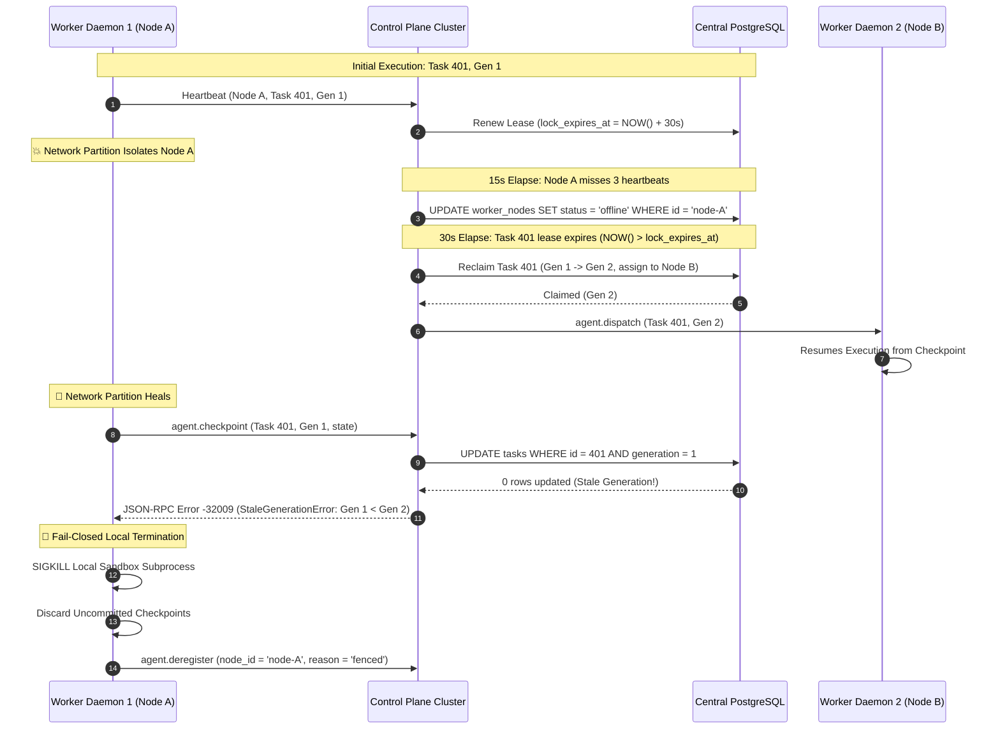

# Specification: Remote Worker Daemon & Heartbeat Distribution

**Reference:** ADR 0034, Vikunja Milestone v0.2-B
**Module:** `personaos.worker_daemon`, `personaos.execution`, `personaos.node`
**Source of Truth:** `schemas/worker.yaml`, `schemas/node.yaml`, `schemas/task.yaml`

---

## 1. Remote Worker Daemon Architecture

The Remote Worker Daemon (`personaos-worker-daemon`) is an autonomous, lightweight process deployed onto target compute nodes (bare-metal servers, cloud VMs, Kubernetes pods). It manages local sandboxes, executes tasks assigned by the control plane, streams telemetry, and maintains server-authoritative heartbeats.

```mermaid
flowchart TD
    subgraph Remote Host Compute Environment
        subgraph DaemonProcess["personaos-worker-daemon"]
            Conn[mTLS WebSocket Client / Transport]
            HB[Heartbeat & Telemetry Agent]
            ExecManager[Task Execution Manager]
            ChkMgr[Checkpoint Manager & Buffer]
            SandboxCtrl[Sandbox & Process Controller]

            HB -->|Ping every 5s| Conn
            Conn -->|agent.dispatch| ExecManager
            ExecManager -->|Launch & Monitor| SandboxCtrl
            ExecManager -->|Step State| ChkMgr
            ChkMgr -->|agent.checkpoint| Conn
        end

        subgraph Local Execution Sandboxes
            Sandbox1["Isolated Execution Sandbox 1<br>(Docker Container / OpenClaw)"]
            Sandbox2["Isolated Execution Sandbox 2<br>(Docker Container / OpenClaw)"]
            SandboxCtrl --> Sandbox1
            SandboxCtrl --> Sandbox2
        end
    end

    subgraph Central Control Plane Cluster
        CP[Control Plane Gateway (mTLS WSS)]
        PG[(Central PostgreSQL Primary)]

        Conn <==>|mTLS Encrypted Stream| CP
        CP <==>|Atomic Leases & Heartbeats| PG
    end
```

---

## 2. Heartbeat Timing & Server-Authoritative Lease Contract

### 2.1 Heartbeat Parameters & Mathematical Contract

| Parameter | Default Value | Description |
|---|---|---|
| `t_heartbeat` | `5.0s` | Interval between daemon heartbeat pings |
| `t_jitter_max` | `1.0s` | Uniform random jitter applied to heartbeat ping (`[0, t_jitter_max]`) |
| `t_node_timeout` | `15.0s` | Maximum time without heartbeat before `NodeSupervisor` marks node `offline` (3 missed heartbeats) |
| `t_lease_ttl` | `30.0s` | In-flight task lease duration in PostgreSQL |
| `t_drain_max` | `60.0s` | Grace period granted to draining node to complete active tasks |

### 2.2 Server-Authoritative Database Operations

To prevent clock skew across physical nodes from invalidating locks, all timestamps are evaluated by PostgreSQL (`NOW()`):

```sql
-- 1. Atomic Node Heartbeat & Status Refresh
UPDATE worker_nodes
SET last_heartbeat_at = NOW(),
    status = CASE
        WHEN status = 'draining' THEN 'draining'
        ELSE 'ready'
    END,
    cpu_utilization = :cpu_pct,
    memory_utilization = :mem_pct,
    updated_at = NOW()
WHERE id = :node_id;

-- 2. In-Flight Task Lease Extension (Guarded by Node ID and Generation)
UPDATE tasks
SET lock_expires_at = NOW() + INTERVAL '30 seconds',
    updated_at = NOW()
WHERE id = :task_id
  AND assigned_node_id = :node_id
  AND generation = :expected_generation;
```

---

## 3. Split-Brain Elimination via Generation Fencing

When a remote worker daemon is partitioned from the network, the control plane will eventually declare the node dead and reclaim its task. When the partitioned daemon reconnects, monotonic generation fencing guarantees it cannot corrupt the newly reclaimed task.



---

## 4. Side-Effect Awareness & Quarantine Pipeline

Tasks consist of a sequence of actions. Each checkpoint and step explicitly declares its idempotency guarantee:

```python
class StepIdempotency(str, Enum):
    STRICTLY_IDEMPOTENT = "strictly_idempotent"      # Safe to replay from beginning (e.g. read, compile, pure function)
    CHECKPOINT_IDEMPOTENT = "checkpoint_idempotent"  # Safe to replay strictly from last committed checkpoint
    NON_IDEMPOTENT = "non_idempotent"                # Unsafe to replay automatically (e.g. payment, irreversible deployment)
```

### 4.1 Eviction and Reclamation Routing

When `NodeSupervisor` detects an expired lease for an in-flight task:
1. **Idempotent Step:**
   If the step metadata indicates `STRICTLY_IDEMPOTENT` or `CHECKPOINT_IDEMPOTENT`:
   - Task status transitions back to `pending`.
   - `generation` is incremented.
   - Task is re-queued for scheduling on another healthy worker node.
2. **Non-Idempotent Step:**
   If the step metadata indicates `NON_IDEMPOTENT`:
   - Task status transitions to `quarantined`.
   - `review_reason` is set to `"unhandled_runtime_error"`.
   - `review_requested_at` is stamped.
   - An event `task.quarantined` is emitted.
   - Automatic execution stops immediately until an operator resolves the task via ADR 0018 endpoints (`POST /api/v1/tasks/{id}/resolve` or `/retry`).

---

## 5. Phased Implementation Roadmap & Acceptance Criteria

### Milestone v0.2-B.1: Remote Worker Daemon Core
- **Deliverables:**
  - `personaos.worker_daemon` executable entrypoint (`worker_daemon_main.py`).
  - Dynamic capability detection (CPU, RAM, GPU, Docker, CLI tools).
  - Sandbox process supervisor supporting subprocess process groups (`os.setpgid`).
- **Acceptance Criteria:**
  - Daemon boots, scans local system capabilities, and authenticates to control plane via mTLS.
  - Clean shutdown on `SIGTERM`: terminates sandbox subprocesses within 5s grace period.

### Milestone v0.2-B.2: Distributed Heartbeat & Dynamic Capacity
- **Deliverables:**
  - Async heartbeat loop with full jitter (`t_heartbeat = 5s`, uniform jitter `0–1s`).
  - In-flight task lease renewal integration in `WorkerExecutionKernel`.
  - Node capacity metrics reporting (active task count vs max concurrency).
- **Acceptance Criteria:**
  - Daemon sustains continuous heartbeats under high CPU load.
  - When node capacity is reached, control plane stops dispatching tasks to the node.

### Milestone v0.2-B.3: Generation Fencing & Fail-Closed Termination
- **Deliverables:**
  - `StaleGenerationConflictError` protocol error handling on daemon.
  - Subprocess force-kill escalation (`SIGTERM` -> 2s timeout -> `SIGKILL`).
- **Acceptance Criteria:**
  - Stale checkpoint rejection immediately kills sandbox process; zero zombie processes remain.

### Milestone v0.2-B.4: Side-Effect Awareness & Quarantine Integration
- **Deliverables:**
  - Integration of step-level idempotency flags with `NodeSupervisor` eviction sweep.
  - Automated routing of interrupted non-idempotent tasks to `quarantined` state.
- **Acceptance Criteria:**
  - Crashed non-idempotent tasks transition to `quarantined` with full execution context preserved.

---

## 6. Multi-Node Chaos & Failure Test Strategy

```
                               Chaos Test Scenarios
┌───────────────────────────────────────┬───────────────────────────────────────────┐
│ Failure Scenario                      │ Test Injection & Verification             │
├───────────────────────────────────────┼───────────────────────────────────────────┤
│ 1. Network Blackhole (30s Drop)       │ Drop packets via mock network layer for   │
│                                       │ 35 seconds. Assert control plane evicts   │
│                                       │ node and reassigns task to standby node.  │
├───────────────────────────────────────┼───────────────────────────────────────────┤
│ 2. Partitioned Node Late Reconnect    │ Let partitioned node resume and post      │
│                                       │ result. Assert result rejected with       │
│                                       │ HTTP 409 / StaleGenerationError.          │
├───────────────────────────────────────┼───────────────────────────────────────────┤
│ 3. Host Clock Skew (+1 hour)          │ Advance worker daemon system time mock    │
│                                       │ by 3600s. Verify leases still respect DB  │
│                                       │ server clock without early expiration.    │
├───────────────────────────────────────┼───────────────────────────────────────────┤
│ 4. SIGKILL During Non-Idempotent Step │ Kill worker daemon mid-action. Run        │
│                                       │ supervisor sweep. Verify task is NOT      │
│                                       │ retried; status == 'quarantined'.         │
└───────────────────────────────────────┴───────────────────────────────────────────┘
```

---

## 7. Open Architectural Decisions Requiring User Approval

1. **Jitter Strategy:**
   - *Recommendation:* Full jitter (`sleep(t_heartbeat + uniform(0, 1.0))`) to prevent thundering herd spikes against the database from synchronized worker boots.
2. **Subprocess Isolation Tier:**
   - *Recommendation:* Support standard POSIX process groups initially, with Docker container runtime optional via configuration (`PERSONAOS_SANDBOX_RUNTIME=docker|process`).
3. **Quarantine Notification Dispatch:**
   - *Recommendation:* Emit an immediate webhook / alert event (`alert.task_quarantined`) whenever a non-idempotent task enters quarantine.
