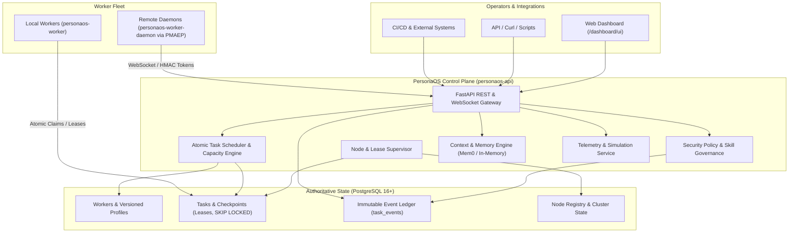
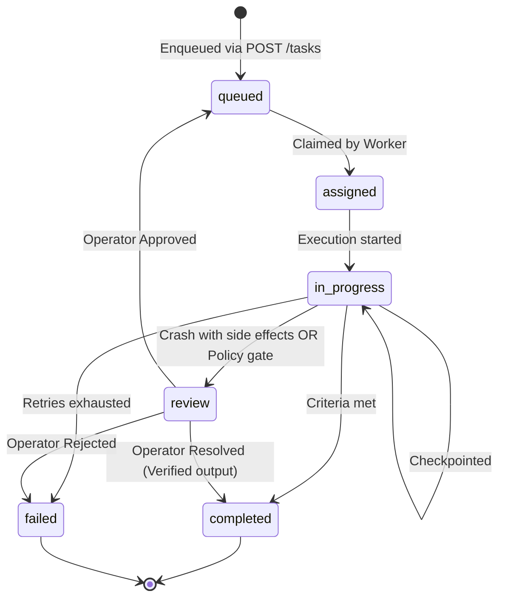

# PersonaOS — User Manual & Operator Guide

> **Build workers. Preserve experience. Simulate work.**

PersonaOS is a persistent workforce operating system for AI agents. Rather than treating an AI agent as a short-lived chat session or an ephemeral script, PersonaOS models each agent as a **long-lived digital employee** equipped with an identity, versioned profiles, skills, persistent memory, and a durable task queue.

This manual provides an end-to-end operational guide for engineers, operators, and developers interacting with PersonaOS.

---

## 1. Core Architecture & Concepts



### Core Entities

| Entity | Description |
|---|---|
| **Worker** | A digital employee with a stable ID, role, personality, and operational status (`active`, `paused`, `quarantined`). |
| **Worker Profile** | An immutable, versioned configuration snapshot (role, runtime, skills, permissions, instructions, model parameters). |
| **Node** | A physical machine, VM, or pod running execution workers, tracked via periodic heartbeats. |
| **Task** | A durable unit of work with defined objectives, priority, side-effect classification, retries, and dependencies. |
| **Checkpoint** | An incremental snapshot of task execution state, allowing resumption after crashes or worker reboots. |
| **Event Ledger** | An append-only audit trail recording every state change, claim, policy decision, and checkpoint. |
| **Memory** | Scoped persistent knowledge (`persona`, `project`, `worker`, `task`, `knowledge`) with confidence scoring and provenance. |

---

## 2. Quickstart & Local Setup

### Prerequisites

- **Python:** 3.12+
- **Docker & Docker Compose:** For running PostgreSQL and containerized services.
- **uv** (recommended) or standard `pip`.

### Starting PersonaOS

1. **Start PostgreSQL Database:**
   ```bash
   make up
   # or: docker compose up -d postgres
   ```

2. **Run Database Migrations:**
   ```bash
   make migrate
   # or: uv run alembic upgrade head
   ```

3. **Seed Initial Example Workers (Optional):**
   ```bash
   make seed
   ```

4. **Launch the Control Plane API:**
   ```bash
   uv run personaos-api
   ```
   - Control Plane REST API: `http://localhost:8000`
   - Interactive OpenAPI Docs: `http://localhost:8000/docs`
   - Operator Web Dashboard: `http://localhost:8000/dashboard/ui`
   - Health Probe: `http://localhost:8000/health`

5. **Start a Worker Execution Process:**
   In a separate terminal:
   ```bash
   uv run personaos-worker --worker-id worker-developer-001 --node-id node-local-01
   ```

---

## 3. Managing AI Workers (Digital Workforce)

Workers in PersonaOS are durable entities. Updating a worker does not mutate existing running tasks; instead, changes create a new profile version.

### 3.1 Registering a Worker

To onboard a new digital employee, send a `POST /workers` request:

```bash
curl -X POST http://localhost:8000/workers \
  -H "Content-Type: application/json" \
  -d '{
    "id": "worker-developer-001",
    "name": "Senior Software Engineer",
    "role": "developer",
    "description": "Full-stack Python and TypeScript engineer for core backend services.",
    "runtime": "openclaw",
    "max_concurrent_tasks": 2,
    "model": "claude-3-5-sonnet",
    "instructions": "Write clean, tested, idiomatic code adhering to PEP 8 and TypeScript strict mode.",
    "skills": ["python", "typescript", "postgres", "docker", "git"],
    "permissions": ["repo.read", "repo.write", "test.run"],
    "persona": {
      "style": "methodical",
      "communication": "concise",
      "autonomy": "high",
      "behavior": {"initiative": "proactive"},
      "goals": ["Maintain 100% test pass rate", "Zero regressions"],
      "constraints": ["Do not execute destructive production commands"]
    }
  }'
```

### 3.2 Worker Persona Dimensions

| Parameter | Options / Values | Description |
|---|---|---|
| `style` | `methodical`, `fast`, `exploratory`, `cautious` | Execution approach and planning depth. |
| `communication`| `concise`, `detailed`, `verbose` | Verbosity of progress updates and reasoning. |
| `autonomy` | `low`, `medium`, `high` | Threshold for requesting human approval on ambiguous decisions. |
| `behavior` | `proactive`, `reactive`, `defensive` | Initiative in suggesting refactorings or additional tests. |
| `goals` | Array of strings | Key business or technical objectives guiding decisions. |
| `constraints` | Array of strings | Guardrails and hard boundaries. |

### 3.3 Upgrading Worker Profiles (Zero-Downtime Evolution)

When an agent learns new skills, requires updated prompts, or switches LLMs, register a new version without disrupting running tasks:

```bash
curl -X POST http://localhost:8000/workers/worker-developer-001/profiles \
  -H "Content-Type: application/json" \
  -d '{
    "version": 2,
    "role": "lead-developer",
    "runtime": "openclaw",
    "max_concurrent_tasks": 3,
    "model": "claude-3-5-sonnet-v2",
    "instructions": "Lead engineer instructions with architectural review responsibility.",
    "skills": ["python", "typescript", "postgres", "docker", "git", "kubernetes"],
    "permissions": ["repo.read", "repo.write", "test.run", "k8s.deploy"],
    "persona": {
      "style": "methodical",
      "communication": "concise",
      "autonomy": "high",
      "behavior": {"initiative": "proactive"}
    }
  }'
```

Tasks already running on `version: 1` continue on their pinned snapshot. Newly scheduled tasks automatically adopt `version: 2`.

### 3.4 Quarantining Misbehaving Workers

If a worker experiences prompt injection, leaks credentials, or repeatedly fails quality gates, quarantine it immediately:

```bash
curl -X POST http://localhost:8000/workers/worker-developer-001/quarantine \
  -H "Content-Type: application/json" \
  -d '{
    "reason": "Exceeded maximum test failure threshold on production branch",
    "quarantined_by": "secops-lead"
  }'
```

- The scheduler instantly stops dispatching tasks to this worker.
- Running tasks are gracefully drained or transitioned to review.
- To reactivate:
  ```bash
  curl -X POST http://localhost:8000/workers/worker-developer-001/unquarantine \
    -H "Content-Type: application/json" \
    -d '{"reason": "Audited and verified patched profile", "actor_id": "secops-lead"}'
  ```

---

## 4. Task Scheduling & Workload Management

### 4.1 Enqueueing Tasks

Submit a task into the durable workload queue via `POST /tasks`:

```bash
curl -X POST http://localhost:8000/tasks \
  -H "Content-Type: application/json" \
  -d '{
    "title": "Implement User Authentication Middleware",
    "objective": "Add JWT validation middleware with role-based route guards in FastAPI.",
    "input": {
      "repository": "PersonaOS/yabby",
      "branch": "feature/jwt-auth",
      "target_file": "src/personaos/api/middleware.py"
    },
    "worker_id": "worker-developer-001",
    "required_skills": ["python", "fastapi", "git"],
    "priority": "high",
    "type": "feature",
    "max_retries": 3,
    "side_effect_classification": "IDEMPOTENT"
  }'
```

### 4.2 Side-Effect Classifications & Crash Safety

PersonaOS provides strict crash recovery guarantees based on `side_effect_classification`:

| Classification | Meaning | Behavior on Worker Crash |
|---|---|---|
| `IDEMPOTENT` | Read-only operations, idempotent builds, pure tests. | Lease expires immediately; another worker reclaims and resumes from the last checkpoint. |
| `HAS_SIDE_EFFECTS` | DB mutations, external webhooks, cloud resource provisioning, Git pushes. | **Safety first:** Automatically routes task to `review` queue. Prevents duplicate external side effects. |
| `UNKNOWN` | Default classification if unspecified. | Routes to `review` queue for operator assessment. |

### 4.3 Task Lifecycle States



### 4.4 Monitoring Tasks & Checkpoints

```bash
# Get task summary and current status
curl -s http://localhost:8000/tasks/<task-id> | jq

# View checkpoint progress
curl -s http://localhost:8000/tasks/<task-id>/checkpoints | jq
```

---

## 5. Human-in-the-Loop & The Review Queue

The review queue ensures AI workers never perform unsafe recovery actions without human operator validation.

### 5.1 When Do Tasks Enter Review?

1. **Crash during Side Effects:** A worker crashes while modifying an external system (`HAS_SIDE_EFFECTS`).
2. **Security Policy Approval Gates:** Actions triggering a `require_approval` rule (e.g., deploying to production, destroying resources).
3. **Outdated Worker Profile:** The worker profile was modified while a long-running task was executing.

### 5.2 Inspecting Review Context

To inspect full diagnostic evidence before making an operational decision:

```bash
curl -s http://localhost:8000/tasks/<task-id>/review-context | jq
```

The response includes:
- Last error message and trace diagnostics.
- Checkpoint history and current checkpoint reference.
- Whether the assigned worker profile has drifted.
- The last 20 immutable event logs leading up to the stoppage.

### 5.3 Operator Resolution Actions

```carousel
```bash
# 1. APPROVE & RESUME
# Re-queues the task to resume from its last valid checkpoint
curl -X POST http://localhost:8000/tasks/<task-id>/approve \
  -H "Content-Type: application/json" \
  -d '{
    "expected_generation": 1,
    "reason": "Verified external resource is in safe state to continue",
    "resume_from_checkpoint": true
  }'
```
<!-- slide -->
```bash
# 2. RESOLVE MANUALLY
# Mark the task completed with operator-verified output
curl -X POST http://localhost:8000/tasks/<task-id>/resolve \
  -H "Content-Type: application/json" \
  -d '{
    "expected_generation": 1,
    "reason": "Manually verified pull request merged cleanly",
    "result": {"status": "success", "pr_url": "https://github.com/..."}
  }'
```
<!-- slide -->
```bash
# 3. REJECT & TERMINATE
# Reject the task and transition permanently to failed
curl -X POST http://localhost:8000/tasks/<task-id>/reject \
  -H "Content-Type: application/json" \
  -d '{
    "expected_generation": 1,
    "reason": "Invalid architectural approach detected"
  }'
```
````

---

## 6. Persistent Memory Subsystem

PersonaOS decouples worker memory from LLM conversation windows. Context is assembled dynamically from structured, provenance-tracked memory records.

### 6.1 Memory Scopes

| Scope | Lifetime | Purpose |
|---|---|---|
| `task` | Lifetime of task | Local working scratchpad and step-level state. |
| `worker` | Permanent to worker | Personal preferences, performance reflections, lessons learned. |
| `persona` | Shared across role | Best practices for role (e.g., all "qa" workers share QA guidelines). |
| `project` | Shared across project | Repository facts, architectural guidelines, code standards. |
| `knowledge` | Global / Organization | Domain documentation, API specs, corporate policies. |

### 6.2 Provenance & Confidence Scoring

Every memory item stored in PersonaOS tracks:
- **`confidence` [0.0 - 1.0]:** Confidence rating. Low-confidence memories (< 0.7) are omitted or flagged during context assembly.
- **`source`:** Actor or task ID responsible for the memory entry.
- **`provenance`:** Direct link to the task event that created or verified the fact.

### 6.3 Memory Adapters

- **`in_memory`:** Fast, volatile adapter ideal for local tests and evaluation.
- **`mem0`:** Enterprise vector database adapter with semantic search and pgvector persistence. Configure via:
  ```env
  MEMORY_ADAPTER=mem0
  MEM0_API_KEY=your-mem0-api-key
  MEM0_BASE_URL=https://api.mem0.ai/v1
  ```

---

## 7. Security Governance & Skill Policies

PersonaOS enforces security policies around every tool call, runtime action, and task transition.

### 7.1 Policy Configuration (`policies/01-standard-roles.yaml`)

```yaml
id: standard-roles-policy
name: Standard Roles Policy
priority: 10
default_effect: deny
version: 1

rules:
  # 1. Prohibit deletion of production resources
  - id: deny-production-destruction
    action: "*:destroy"
    resource: "prod*"
    effect: deny

  # 2. Gate production deployments behind operator approval
  - id: gate-production-deployment
    action: "task:deploy"
    resource: "prod*"
    effect: require_approval

  # 3. Allow standard development execution
  - id: allow-task-execution
    action: "task:*"
    resource: "*"
    effect: allow
```

### 7.2 Inspecting Policy Denials

When a worker attempts an unauthorized tool execution or resource access, PersonaOS blocks the action and emits an audit event:

```bash
curl -s "http://localhost:8000/events?type=policy.denied&limit=10" | jq
```

---

## 8. Interactive Web Dashboard

PersonaOS includes a built-in, real-time operator console served directly from the control plane at `/dashboard/ui`.

```
+---------------------------------------------------------------------------------------+
|  PersonaOS Dashboard — Persistent AI Workforce & Workload Operations                 |
+---------------------------------------------------------------------------------------+
|  [Queued: 4]   [In Progress: 2]   [Completed: 18]   [Failed: 1]   [Spend: $1.42]      |
+---------------------------------------------------------------------------------------+
|  WORKER FLEET                                                                         |
|  Worker ID           Role        Status    Active Tasks   Success Rate   Avg Quality  |
|  worker-dev-01       developer   ACTIVE    1              94.2%          0.91         |
|  worker-devops-01    devops      ACTIVE    1              100.0%         0.95         |
|  worker-qa-01        qa          ACTIVE    0              88.5%          0.87         |
+---------------------------------------------------------------------------------------+
```

### Accessing Dashboard & Metrics APIs

- **Dashboard UI:** Navigate to `http://localhost:8000/dashboard/ui` in your browser.
- **Workload Summary API:**
  ```bash
  curl -s http://localhost:8000/dashboard/workload | jq
  ```
- **Worker Fleet Status API:**
  ```bash
  curl -s http://localhost:8000/dashboard/workers | jq
  ```

---

## 9. Simulation & Team Modeling

Before dispatching expensive or complex multi-agent tasks to production LLMs, use the PersonaOS Simulation Engine to estimate completion time, token expenditure, and identify team bottlenecks.

### 9.1 Simulating Workload Scenarios

```bash
curl -X POST http://localhost:8000/api/v1/simulation/simulate \
  -H "Content-Type: application/json" \
  -d '{
    "tasks": [
      {"id": "sim-task-1", "skills": ["python"], "priority": "high", "dependencies": []},
      {"id": "sim-task-2", "skills": ["docker"], "priority": "medium", "dependencies": ["sim-task-1"]}
    ],
    "worker_pool": ["worker-developer-001", "worker-devops-001"],
    "model_override": "gpt-4o"
  }' | jq
```

### 9.2 Empirical Calibration

The simulation engine automatically calibrates its duration and cost models against the historical event ledger (`task_events`), ensuring estimates reflect real-world execution velocity.

---

## 10. Distributed Workforce (PMAEP Protocol)

In distributed setups (v0.2+), workers run across separate physical machines, cloud VMs, or Kubernetes pods using the **Cross-Machine Agent Execution Protocol (PMAEP)** over WebSockets.

### 10.1 Running a Remote Worker Daemon

On execution nodes (e.g. GPU machines or sandbox runners), launch `personaos-worker-daemon`:

```bash
uv run personaos-worker-daemon \
  --worker-id worker-gpu-01 \
  --node-id node-site2-compute-01 \
  --control-plane-ws "ws://controlplane.internal:8000/api/v1/cluster/ws" \
  --heartbeat-interval 5.0
```

- Daemons maintain a persistent WebSocket stream.
- Checkpoints and execution telemetry stream back to the control plane in real time.
- Heartbeats include cryptographic HMAC authentication and random jitter to eliminate thundering herd spikes.

### 10.2 Graceful Node Draining

Before taking an execution node down for maintenance or OS patching:

```bash
curl -X POST http://localhost:8000/api/v1/cluster/nodes/node-site2-compute-01/drain
```

The node will finish currently active tasks but will reject new claims.

---

## 11. REST API Cheat Sheet

| Task | HTTP Method & Path | Primary Payload / Parameters |
|---|---|---|
| **Health Check** | `GET /health` | None |
| **List Workers** | `GET /workers` | `?status=active&role=developer` |
| **Register Worker** | `POST /workers` | Worker ID, role, persona, instructions |
| **Upgrade Profile** | `POST /workers/{id}/profiles` | New version, updated skills/instructions |
| **Quarantine Worker**| `POST /workers/{id}/quarantine` | `reason`, `quarantined_by` |
| **Enqueue Task** | `POST /tasks` | `title`, `objective`, `worker_id`, `priority` |
| **List Tasks** | `GET /tasks` | `?status=in_progress&limit=20` |
| **List Review Tasks**| `GET /tasks/review` | None |
| **Approve Task** | `POST /tasks/{id}/approve` | `expected_generation`, `resume_from_checkpoint` |
| **Resolve Task** | `POST /tasks/{id}/resolve` | `expected_generation`, `result` |
| **Reject Task** | `POST /tasks/{id}/reject` | `expected_generation`, `reason` |
| **Task Checkpoints** | `GET /tasks/{id}/checkpoints` | None |
| **Query Audit Log** | `GET /events` | `?type=task.claimed&limit=50` |
| **Cluster Nodes** | `GET /api/v1/cluster/nodes` | None |
| **Drain Node** | `POST /api/v1/cluster/nodes/{id}/drain` | None |
| **Dashboard UI** | `GET /dashboard/ui` | Open in web browser |

---

## 12. Troubleshooting & FAQ

### Q: Why is my worker not claiming tasks from the queue?
1. **Worker Status:** Check if the worker is active: `curl http://localhost:8000/workers/<id>`. If status is `quarantined` or `paused`, unquarantine it.
2. **Node Heartbeat:** If the worker node hasn't sent a heartbeat within `NODE_HEARTBEAT_TIMEOUT_SECONDS` (default: 60s), the scheduler treats the node as offline.
3. **Skill Mismatch:** If a task specifies `required_skills: ["kubernetes"]` and the worker's active profile only lists `["python"]`, the scheduler will skip that worker.

### Q: What should I do if a task is stuck in `review`?
1. Fetch the diagnostics: `curl http://localhost:8000/tasks/<id>/review-context | jq`.
2. Inspect `execution_evidence.last_error`.
3. If the external state is intact, approve and resume: `POST /tasks/<id>/approve` with `"resume_from_checkpoint": true`.
4. If the work was already completed manually, resolve it: `POST /tasks/<id>/resolve` with `"result": {...}`.

### Q: How do I backup the database?
PersonaOS stores all authoritative state in PostgreSQL. The `task_events` table is an immutable append-only ledger preserving full execution provenance:

```bash
pg_dump -h localhost -U personaos -F c -b -v -f personaos_backup.dump personaos
```
