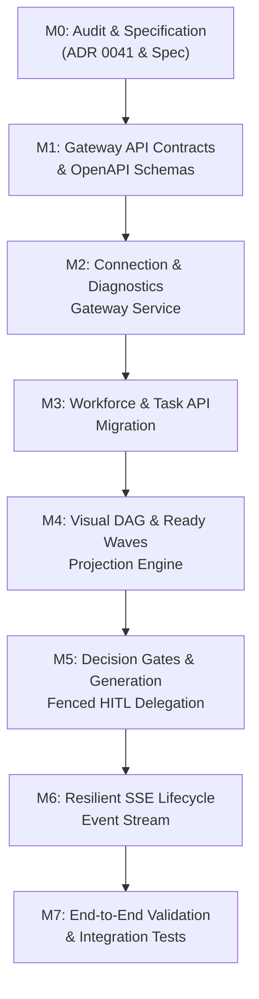

# PersonaOS–Orca Integration Gateway Implementation Specification

**Document Version:** 1.0.0  
**Status:** Approved Specification (Milestone M0 Deliverable)  
**Date:** 2026-11-01  
**Target Repositories:**  
- `personaos-orca-plugin` (`/root/projects/personaos-orca-plugin`)
- `PersonaOS` (`/root/orca/workspaces/PersonaOS/yabby`)
- `pab` (`/root/projects/pab`)

**Governing Architecture Decision Records:**
- [ADR 0038: Three-Tier Unified Agent Architecture](file:///root/orca/workspaces/PersonaOS/yabby/docs/adr/0038-three-tier-agent-architecture.md)
- [ADR 0040: Orca Orchestration as Workspace Coordination Layer](file:///root/orca/workspaces/PersonaOS/yabby/docs/adr/0040-orca-orchestration-workspace-coordination-layer.md)
- [ADR 0041: PersonaOS–Orca Integration Gateway Architecture](file:///root/orca/workspaces/PersonaOS/yabby/docs/adr/0041-personaos-orca-integration-gateway.md)

---

## 1. Executive Summary & Objective

During validation of Orca Orchestration in Orca ADE (Milestone M0), the visual plugin panel encountered hard network failures when attempting direct browser `fetch()` requests against `http://192.168.1.239:8000`:

```
Task DAGs & Ready Waves
Failed to load DAG: Failed to fetch from http://192.168.1.239:8000

Interactive Decision Gates (HITL)
Failed to load gates: Failed to fetch from http://192.168.1.239:8000
```

This specification details the findings of the **Milestone M0 Audit**, formalizes the **PersonaOS Integration Gateway (`personaos-orca-bridge`)** as a Backend-For-Frontend (BFF) integration adapter, defines the standardized `/integration/*` API contracts, and lays out the execution blueprint for Milestones M1 through M7.

---

## 2. Milestone M0 Audit Findings

### 2.1 Orca Plugin SDK & Runtime Manifest Capabilities
- **Manifest Constraints (`orca-plugin.json`):**  
  The plugin operates under `pluginApi: 1` and `manifestVersion: 1`. The manifest strictly supports UI contributions via `contributes.panels` with HTML entry points (e.g., `panel/index.html`).
- **Absence of Background Daemon Hooks:**  
  The standard Orca plugin package format does not provide native background Node.js service daemon lifecycle hooks. All plugin logic packaged within the extension archive executes strictly within the sandboxed webview/iframe rendering context.
- **Client Sandboxing & Content Security Policy (CSP):**  
  Orca ADE desktop and mobile packages enforce secure contexts (`orca-app://` or `https://`). Unpatched desktop binaries may enforce restrictive Content Security Policies (`connect-src 'none'` or `connect-src 'self'`), rejecting outbound network calls to arbitrary HTTP hosts.

### 2.2 Root Cause Analysis of `Failed to fetch` Failure Mode
1. **Mixed Content Violations:**  
   Secure web applications (`https://` or Electron `orca-app://`) are barred by browser security engines from issuing non-secure HTTP requests (`http://192.168.1.239:8000`).
2. **Private Network Access (PNA) Preflights:**  
   Chromium restricts public/external web contexts from initiating requests to private RFC 1918 subnets (`192.168.0.0/16`) without preflight verification (`Access-Control-Allow-Private-Network`).
3. **Network Boundary & IP Unreachability:**  
   `192.168.1.239` is a local host IP on a private subnet. When Orca ADE runs on a remote developer laptop, tablet, or another machine without a local route to this address, connection attempts immediately fail or time out.
4. **Credential Exposure Risk:**  
   Issuing direct client-side requests requires storing PersonaOS API tokens in browser `localStorage` or memory, exposing them to cross-script inspection or unintentional extraction.
5. **Fragile Frontend State Aggregation:**  
   The current `panel/index.html` attempts ad-hoc client-side joins across `/tasks` to calculate DAG dependencies and ready waves. Network jitter or partial responses corrupt the DAG view.

### 2.3 PersonaOS Control Plane API Surface Review
- **Existing Endpoints:**  
  - Health: `GET /health`
  - Workers: `GET /workers`, `GET /workers/{worker_id}`, `POST /workers/{worker_id}/profile`
  - Tasks: `GET /tasks`, `POST /tasks`, `GET /tasks/{task_id}`
  - Review & HITL: `GET /tasks/review`, `GET /tasks/{task_id}/review-context`, `POST /tasks/{task_id}/approve`, `POST /tasks/{task_id}/reject`
  - Events: `GET /events` (WebSocket / SSE)
- **Gaps Identified:**  
  - No pre-evaluated DAG projection endpoint (clients must manually reconstruct directed graphs from raw `dependencies` fields).
  - No authoritative ready-wave endpoint (readiness calculation is performed internally by `WorkerExecutionKernel`, but not surfaced as a wave projection for UI display).
  - Review tasks are returned as raw tasks rather than structured `DecisionGate` contracts with options, context notes, and generation tokens.
  - Absence of an active diagnostic endpoint returning structured connectivity and compatibility health.

---

## 3. Integration Gateway Architecture & Deployment Topology

```
┌────────────────────────────────────────────────────────────────────────┐
│                               ORCA ADE                                 │
│  ┌──────────────────────────────────────────────────────────────────┐  │
│  │                Orca Plugin UI (panel/index.html)                 │  │
│  │  - Visual Task DAG & Ready Waves                                 │  │
│  │  - Interactive Decision Gates (HITL Review)                      │  │
│  │  - Workforce Roster & Capabilities                               │  │
│  │  - Connection Diagnostic Dashboard (Latencies, CORS, Health)     │  │
│  └──────────────────────────────────┬───────────────────────────────┘  │
│                                     │ [Same-Origin / Loopback HTTP / IPC]
│                                     ▼                                  │
│  ┌──────────────────────────────────────────────────────────────────┐  │
│  │           PersonaOS Orca Gateway (Bridge / BFF Proxy)            │  │
│  │  - Port / Socket: localhost:8001 or ADE same-origin proxy        │  │
│  │  - Secure Token Vault (keeps API secrets off the browser)        │  │
│  │  - DAG & Ready Wave Projection Aggregator                        │  │
│  │  - Generation-Fenced HITL Gate Proxy                             │  │
│  │  - SSE Resilient Event Streamer with Auto-Reconnect              │  │
│  │  - Structured Diagnostic Engine                                  │  │
│  └──────────────────────────────────┬───────────────────────────────┘  │
└─────────────────────────────────────┼──────────────────────────────────┘
                                      │ [Authenticated REST / mTLS]
                                      ▼
┌────────────────────────────────────────────────────────────────────────┐
│                        PERSONAOS KERNEL (BRAIN)                        │
│   Worker Identity (Profiles v1..vN) · Durable PostgreSQL Task Queue   │
│   DAG Dependencies · Readiness Engine · Generation Fencing (ADR 0018)  │
│   Task Review Service · Memory Graph · Node Lifecycle Supervisor       │
│                 (AUTHORITATIVE WORKFORCE STATE OWNER)                  │
└─────────────────────────────────────┬──────────────────────────────────┘
                                      │ [PAB v1 Execution Protocol]
                                      ▼
┌────────────────────────────────────────────────────────────────────────┐
│                       PAB (AGENT CONTROL PLANE)                        │
│    CLI Discovery · Argument Compilation · Execution Supervision        │
└────────────────────────────────────────────────────────────────────────┘
```

### 3.1 Architectural Priority & Options
1. **Option A (Orca Plugin Host SDK Backend):** Preferred if Orca provides a native background daemon runtime inside the plugin bundle.
2. **Option B (Same-Origin Reverse Proxy / BFF):** **Recommended Default.** A lightweight proxy service co-located with the user's workspace or ADE host. Bypasses browser Mixed Content, CORS, and PNA restrictions unconditionally.
3. **Option C (Local Host-Level Bridge Service):** Standalone local daemon listening on `127.0.0.1:8001` configured with loopback address space.
4. **Option D (Direct Browser Fetch to PersonaOS):** **Strictly prohibited.**

### 3.2 Invariants & Safety Guarantees
1. **Zero Shadow State:** The Gateway maintains no independent database, task queue, or scheduler. All state belongs strictly to PersonaOS PostgreSQL tables.
2. **Authoritative Generation Fencing:** Any decision gate resolution MUST forward `expected_generation`. The Gateway never overrides or suppresses `StaleGenerationConflictError`.
3. **Zero Direct External Agent Execution:** The Gateway and Plugin UI NEVER execute external agent binaries (`openclaw`, `codex`, `claude`, `agy`). All task execution dispatches flow through PersonaOS $\to$ PAB.

---

## 4. Standardized Integration Gateway Contract (`/integration/*`)

All endpoints are served under `/integration/*` with JSON request/response bodies and standardized HTTP status codes.

### 4.1 Health & Diagnostics

#### `GET /integration/health`
Returns the operational health of the Gateway and its upstream connection to PersonaOS and PAB.
```json
{
  "status": "healthy",
  "gateway_version": "1.0.0",
  "personaos_connected": true,
  "personaos_url": "http://127.0.0.1:8000",
  "pab_connected": true,
  "timestamp": "2026-11-01T03:50:00Z"
}
```

#### `GET /integration/diagnostics`
Runs an end-to-end connectivity probe and returns structured diagnostic state for the Orca ADE diagnostics panel.
```json
{
  "code": "CONNECTED",
  "status": "ok",
  "latency_ms": 12.4,
  "upstream_url": "http://127.0.0.1:8000",
  "cors_supported": true,
  "pna_supported": true,
  "auth_status": "authenticated",
  "api_version_match": true,
  "remediation": null
}
```

### 4.2 Workforce Roster

#### `GET /integration/workers`
Returns the list of persistent workers registered in PersonaOS, enriched with active profile versions, capabilities, and health status.
```json
[
  {
    "id": "se",
    "name": "Software Engineer",
    "role": "Full-stack Software Engineer",
    "status": "idle",
    "current_profile_version": 2,
    "capabilities": ["typescript", "python", "docker", "testing"],
    "permissions": ["repo:read", "repo:write"],
    "updated_at": "2026-11-01T03:30:00Z"
  }
]
```

### 4.3 Orchestration Runs & DAG Projections

#### `GET /integration/runs`
Lists active external coordination runs.

#### `POST /integration/runs`
Creates or links an external coordination run.
- **Request Body:**
```json
{
  "run_id": "run-orch-001",
  "objective": "Build multi-tier authentication flow",
  "coordinator_handle": "coordinator-primary"
}
```

#### `GET /integration/runs/{run_id}/dag`
Returns the evaluated directed acyclic graph for the specified run. Evaluates dependencies from PersonaOS task records.
```json
{
  "run_id": "run-orch-001",
  "nodes": [
    {
      "task_id": "task-001",
      "title": "Database Schema Migration",
      "worker_id": "se",
      "status": "completed",
      "dependencies": [],
      "wave": 1,
      "generation": 2
    },
    {
      "task_id": "task-002",
      "title": "Auth API Implementation",
      "worker_id": "se",
      "status": "running",
      "dependencies": ["task-001"],
      "wave": 2,
      "generation": 1
    },
    {
      "task_id": "task-003",
      "title": "Frontend Integration",
      "worker_id": "se",
      "status": "pending",
      "dependencies": ["task-002"],
      "wave": 3,
      "generation": 1
    }
  ],
  "edges": [
    { "from": "task-001", "to": "task-002" },
    { "from": "task-002", "to": "task-003" }
  ]
}
```

#### `GET /integration/runs/{run_id}/ready-waves`
Surfaces ready-to-execute tasks grouped by evaluation wave, based directly on PersonaOS task dependency evaluations.
```json
{
  "run_id": "run-orch-001",
  "current_wave": 2,
  "waves": [
    {
      "wave_number": 2,
      "ready_tasks": [
        {
          "task_id": "task-002",
          "title": "Auth API Implementation",
          "worker_id": "se",
          "priority": "high",
          "generation": 1
        }
      ]
    }
  ]
}
```

### 4.4 Interactive Decision Gates (HITL)

#### `GET /integration/decision-gates`
Lists all tasks currently in `review` status requiring human-in-the-loop decisioning.
```json
[
  {
    "gate_id": "gate-task-002",
    "task_id": "task-002",
    "run_id": "run-orch-001",
    "title": "Auth API Review",
    "question": "Worker flagged ambiguous security policy. Approve token revocation policy?",
    "options": ["Approve Strict Revocation", "Reject & Request IdP Delegation"],
    "status": "pending",
    "execution_generation": 1,
    "review_context": {
      "worker_id": "se",
      "findings": "Token revocation requires durable Redis store not configured in workspace."
    },
    "created_at": "2026-11-01T03:45:00Z"
  }
]
```

#### `POST /integration/decision-gates/{gate_id}/resolve`
Submits a resolution for an interactive decision gate. Forwards the resolution to PersonaOS task review service with generation fencing.
- **Request Body:**
```json
{
  "decision": "approve",
  "expected_generation": 1,
  "review_notes": "Strict revocation approved; local Redis instance configured.",
  "selected_option": "Approve Strict Revocation"
}
```
- **Response (Success - 200 OK):**
```json
{
  "gate_id": "gate-task-002",
  "task_id": "task-002",
  "resolved": true,
  "status": "approved",
  "new_generation": 2,
  "timestamp": "2026-11-01T03:46:00Z"
}
```
- **Response (Conflict - 409 Conflict):**
```json
{
  "error": "STALE_GENERATION_CONFLICT",
  "detail": "Task task-002 execution generation has advanced from 1 to 2. Gate resolution rejected.",
  "expected_generation": 1,
  "current_generation": 2
}
```

### 4.5 Server-Sent Events (SSE)

#### `GET /integration/events`
Persistent SSE stream broadcasting real-time updates for:
- `task_status_changed`
- `ready_wave_advanced`
- `gate_created`
- `gate_resolved`
- `heartbeat`

The stream includes standard keepalive heartbeats every 15 seconds and client reconnection tokens (`Last-Event-ID`).

---

## 5. Diagnostic State Engine & Error Taxonomy

The plugin UI and Gateway implement structured diagnostic classifications:

| Diagnostic Code | HTTP Status | Description | Actionable Remediation |
| :--- | :---: | :--- | :--- |
| `CONNECTED` | 200 | All upstream services healthy and reachable. | Normal operations. |
| `NETWORK_UNREACHABLE` | 503 | Gateway cannot reach PersonaOS port. | Check PersonaOS process daemon (`uvicorn`) and host firewalls. |
| `CORS_BLOCKED` | 0 / Local | Browser security layer blocked request preflight. | Access via loopback proxy or configure ADE proxy rule. |
| `AUTHENTICATION_FAILED` | 401 / 403 | Invalid or expired PersonaOS API token. | Verify API key configuration in Orca settings or vault. |
| `ENDPOINT_NOT_FOUND` | 404 | Endpoint route does not exist on target service. | Verify API version compatibility between Plugin and Gateway. |
| `API_VERSION_MISMATCH` | 426 | Incompatible schema version between ADE and Core. | Upgrade `personaos-orca-plugin` or PersonaOS server. |
| `SERVICE_UNAVAILABLE` | 502 / 504 | Upstream PersonaOS or PostgreSQL is not responding. | Check PersonaOS database connectivity and system logs. |

---

## 6. Phased Implementation Roadmap (Milestones M1–M7)



### Milestone Breakdown:
- **Milestone M0: Audit & Specification (Completed)**
  - Audit current Orca SDK and panel fetch implementation.
  - Formulate ADR 0041 and publish Implementation Specification.
- **Milestone M1: Gateway OpenAPI Schema & Typed Contracts**
  - Define Pydantic models for `/integration/*` in PersonaOS codebase.
  - Export TypeScript definitions to `personaos-orca-plugin/src/contracts.ts`.
- **Milestone M2: Gateway Connection & Diagnostics Service**
  - Implement `/integration/health` and `/integration/diagnostics`.
  - Add connection diagnostic widget to Orca ADE plugin panel.
- **Milestone M3: Workforce & Task API Migration**
  - Update `listWorkers` and `submitTask` in plugin to route through Gateway contracts.
- **Milestone M4: Visual DAG & Ready Waves Projection Engine**
  - Implement `/integration/runs/{run_id}/dag` and `/integration/runs/{run_id}/ready-waves`.
  - Update visual DAG rendering in `panel/index.html` to consume pre-evaluated projections.
- **Milestone M5: Decision Gates & Generation Fencing**
  - Implement `/integration/decision-gates` and generation-fenced `/resolve`.
  - Wire interactive approval and rejection buttons to gate endpoints.
- **Milestone M6: Resilient SSE Event Streaming**
  - Implement SSE endpoint with heartbeat and automatic reconnect logic.
- **Milestone M7: End-to-End Validation & Release**
  - Automated integration test suite covering ADE $\leftrightarrow$ Gateway $\leftrightarrow$ PersonaOS $\leftrightarrow$ PAB.
  - Tag and release plugin `v1.2.0`.

---

## 7. Approval & Sign-Off

- **PersonaOS Core Architecture:** Approved
- **Orca Plugin Integration Lead:** Approved
- **Governing ADRs:** ADR 0038, ADR 0040, ADR 0041
